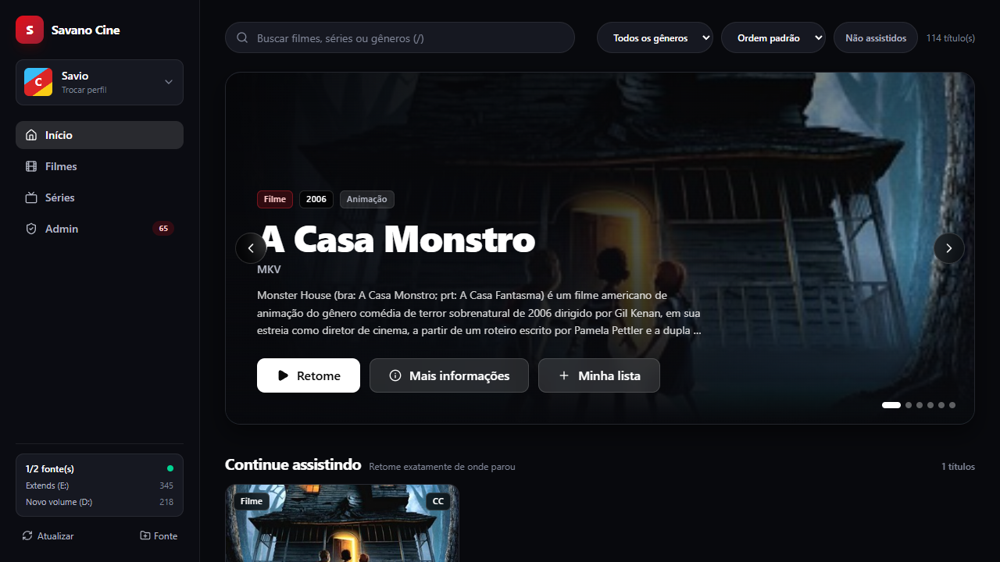

# Savano Cine

Transforme acervos pessoais de filmes e séries espalhados em HDs locais ou drives removíveis em uma **plataforma de streaming local estilo Netflix** — rápida, privada e **100% não destrutiva** (nenhum arquivo físico é movido, renomeado ou apagado).

---

## Demonstração

<video src="docs/media/demo.webm" controls width="100%">
  Veja o vídeo de demonstração em <a href="docs/media/demo.webm">docs/media/demo.webm</a>.
</video>

| Tela Inicial (Hero & Carrosséis) | Console Admin (Diagnóstico & Arte) |
| --- | --- |
|  |  |

---

## Proposta e o que o projeto soluciona

Quem mantém filmes e séries em HDs externos costuma enfrentar quatro problemas: pastas com nomes poluídos por tags de release, falta de capas/sinopses unificadas, séries com episódios misturados e perda de progresso ao assistir em diferentes momentos.

O **Savano Cine** resolve isso com:

- **Preservação total do acervo**: o scanner lê seus discos em modo somente-leitura. Limpeza de títulos, agrupamento de versões (`1080p` / `720p`), correções e arquivamentos ficam apenas no SQLite local (`data/catalog.db`), com histórico e restauração reversível.
- **Capas e metadados locais**: busca pôsteres, sinopses e gêneros (IMDb, Wikipedia PT/EN, TVMaze e TMDB opcional) e salva tudo localmente em `data/artwork`, evitando depender de APIs externas a cada carregamento.
- **Fontes removíveis resilientes**: reconhece HDs pelo identificador/volume do Windows e atualiza o status `online`/`offline` automaticamente sem apagar o catálogo quando o disco é desconectado.
- **Perfis independentes**: múltiplos perfis com avatares temáticos, *Minha Lista*, avaliações e ponto de retomada separados por pessoa.
- **Player completo**:
  - Streaming HTTP com suporte a `Range` (seek instantâneo) e transcoding sob demanda via FFmpeg/FFprobe para troca de faixa de áudio mantendo a posição real na timeline.
  - **Boost de volume até 300%** via Web Audio API (`GainNode` + limitador suave) para filmes com áudio baixo.
  - Controle de velocidade (`0.75x` a `2x`), *Picture-in-Picture*, legendas locais `.srt`/`.vtt` ou embutidas, e miniaturas de preview na barra de progresso.
- **Diagnóstico e manutenção simples**: ao baixar novos filmes no futuro, basta clicar em **Atualizar catálogo** (ou abrir **Admin → Arte & Metadados**) para escanear, limpar títulos, buscar capas faltantes e até copiar um prompt pronto caso algum arquivo atípico precise de ajuste.

---

## Como organizar seus arquivos

Você não precisa renomear seus arquivos existentes para começar, mas seguir a estrutura abaixo garante classificação automática imediata:

```text
D:\Filmes\
├── A Casa Monstro (2006)\
│   ├── A.Casa.Monstro.2006.1080p.mkv
│   └── A.Casa.Monstro.2006.pt.srt
├── Marvel\
│   └── Vingadores Ultimato (2019)\
│       └── Vingadores.Ultimato.2019.mkv
└── South Park\
    ├── 1\
    │   ├── S01E01 - Cartman Tem uma Sonda Anal.mkv
    │   └── S01E02 - Ganhe Peso 4000.mkv
    └── Curtas\
        └── Especial.mkv
```

### Regras recomendadas
- **Filmes**: podem ficar na raiz ou dentro de subpastas de franquias/gêneros (`Marvel/`, `DC/`, `Terror/`). Clipes promocionais de release são ignorados automaticamente.
- **Séries**: coloque dentro de uma pasta com o nome da série e subpastas numéricas de temporada (`1`, `2`, `Season 01`, etc.) ou `Curtas` para especiais. Episódios com `SxxExx` ou `xx.yy` são agrupados automaticamente sob o mesmo card da série.
- **Legendas**: salve `.srt` ou `.vtt` na mesma pasta com o mesmo prefixo do vídeo (ex.: `Filme.pt.srt`, `Filme.en.vtt`).

---

## Como executar

### Pré-requisitos
- **Node.js 22+** (usa `node:sqlite` nativo).
- *(Opcional)* **FFmpeg / FFprobe** no `PATH` (ou via `CINE_FFMPEG_PATH` / `CINE_FFPROBE_PATH`) para análise de faixas de áudio, transcoding MP4 e miniaturas na timeline.

### Passo a passo

```bash
# 1. Instalar dependências
npm install

# 2. Escanear suas pastas de mídia (ex.: D:\Filmes e E:\Filmes)
npm run scan

# 3. Baixar capas, sinopses e gêneros localmente
npm run artwork

# 4. Iniciar a API (porta 4174) e o frontend (porta 5173) em terminais separados
npm run api
npm run dev
```

No Windows, você também pode iniciar/reiniciar ambos os servidores em segundo plano com um comando:

```powershell
powershell -NoProfile -ExecutionPolicy Bypass -File scripts/launch-cine-local.ps1
```

Acesse **`http://127.0.0.1:5173`** no navegador.

### Variáveis de ambiente opcionais
| Variável | Descrição |
| --- | --- |
| `CINE_API_PORT` | Porta da API local (padrão: `4174`). |
| `TMDB_API_KEY` | Chave opcional do TMDB para banners widescreen extras. |
| `OPENSUBTITLES_API_KEY` | Chave opcional para busca de legendas no OpenSubtitles. |
| `CINE_FFMPEG_PATH` / `CINE_FFPROBE_PATH` | Caminho explícito para os binários do FFmpeg/FFprobe. |

---

## Adicionando novos filmes depois

1. Copie os novos filmes ou episódios para as pastas configuradas.
2. Clique em **Atualizar catálogo** na barra lateral: o sistema executa automaticamente o scanner, reconcilia episódios, limpa os títulos e dispara a busca de capas/sinopses.
3. Para conferir se sobrou alguma pendência, abra **Admin → Arte & Metadados** para ver o **Diagnóstico do Catálogo** (`Sem capa`, `Sem sinopse`, `Sem gênero`, `Títulos suspeitos`) e, se necessário, clique em **Copiar prompt de correção**.

---

## Scripts de verificação e testes

```bash
npm run lint        # Verificação estática com oxlint
npm run test:unit   # Testes unitários (limpeza de títulos e helpers)
npm run build       # Build TypeScript + Vite
npm run doctor      # Diagnóstico do ambiente, banco e fontes
npm run smoke       # Smoke tests da API (15 verificações)
npm run verify      # Verificação funcional ponta a ponta da API
npm run test:e2e    # Suíte Playwright E2E dos fluxos críticos
```
