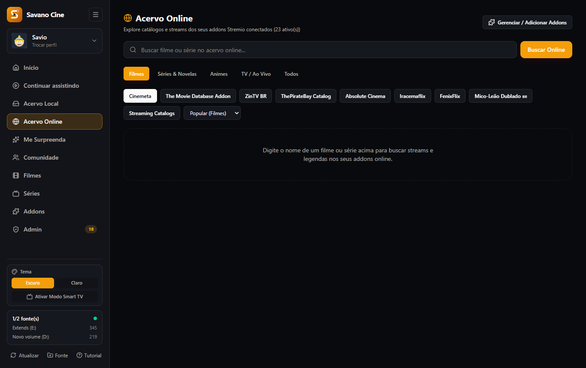
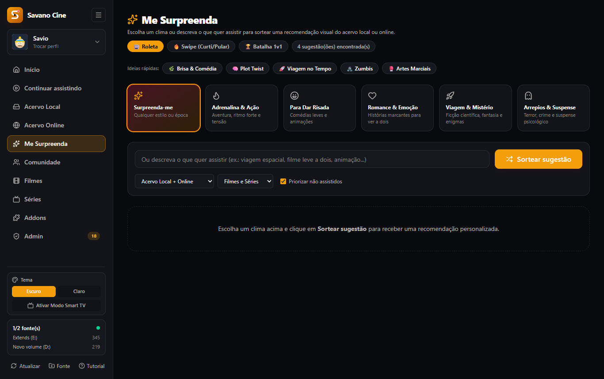
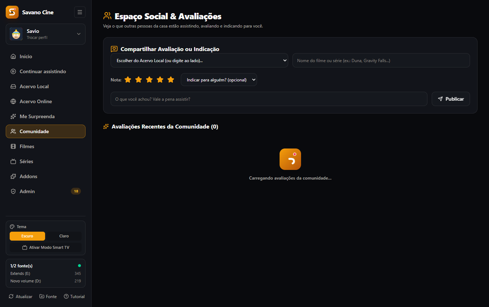
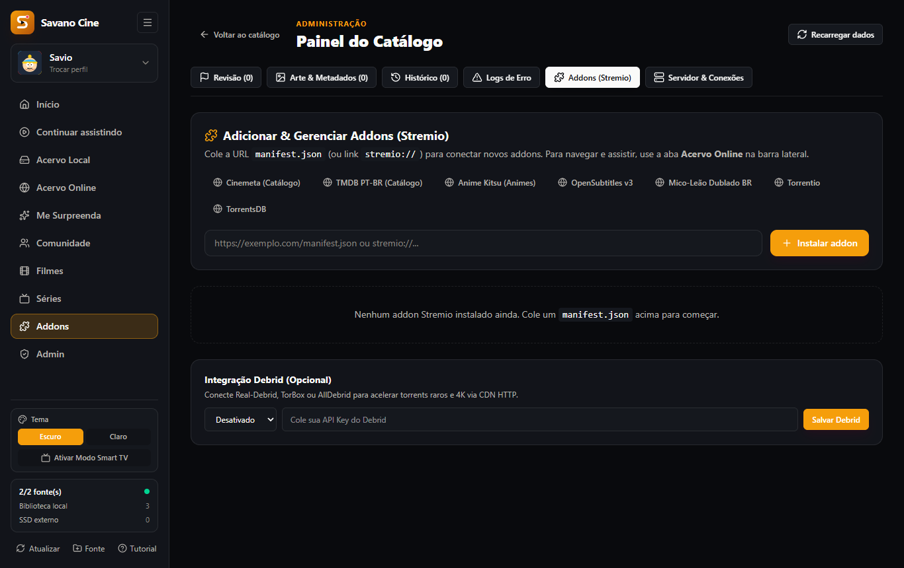

# 🎬 Savano Cine

> **Seu media center pessoal + streaming via addons Stremio**, com interface inspirada em cinema (*Noir Âmbar*), perfis independentes, player avançado com dual-subtitle, controle remoto pelo celular e zero dependência de nuvem paga.


---

## ✨ Principais Recursos

- **Acervo Local + Online Unificado**: navegue pelos seus filmes/séries em HDs locais (inclusive unidades removíveis identificadas por volume) lado a lado com catálogos de **addons Stremio** (Cinemeta, TMDB, Anime Kitsu, Torrentio, FenixFlix, etc.).
- **Streaming Otimizado & Auto-Fallback**:
  - Motor WebTorrent sob demanda com isolamento de peças, prioridade para *moov atom* em MP4, pré-aquecimento (`torrent-prepare`), proxy HTTP/HLS com suporte a `proxyHeaders` e fallback automático para transcode FFmpeg.
  - Seleção inteligente da **Melhor Fonte** em 1 clique + troca automática caso um torrent fique sem peers.
- **Player Cinematográfico Completo**:
  - **2ª Legenda (Estudo de Idioma)** simultânea com layout e cor personalizáveis, busca integrada nos addons, sincronia (`±0.5s`) e fundo ajustável.
  - **Modo Noite** (compressor dinâmico), **Boost de Volume até 300%**, **Auto-Pular Abertura (+85s)**, **Miniplayer**, **Watch Party** (assistir junto via SSE) e **Controle Remoto pelo Celular** via QR Code na rede Wi-Fi.
- **Descoberta Divertida (*Me Surpreenda*)**:
  - Três modos interativos para acabar com a indecisão: **🎰 Roleta**, **🔥 Swipe (Curti/Pular)** e **🏆 Batalha 1v1 (Cine-Cup)**, com filtros de clima, busca temática PT-BR/EN e ideias rápidas.
- **Perfis, Comunidade & Smart TV**:
  - Perfis isolados (`Admin` / `Convidado` / `Infantil`), **Espaço Social** com notas/avaliações e indicações entre perfis, **Modo Smart TV (10-foot UI)** e **Tutorial Interativo** para novos usuários.

---

## 📸 Visão Geral das Telas

### Acervo Online (Addons Stremio + TV ao Vivo separada)


### Me Surpreenda (Roleta, Swipe & Batalha 1v1)


### Espaço Social & Avaliações


### Painel Admin & Gerenciador de Addons


---

## 🛠️ Requisitos

- **Node.js 22+** (usa `node:sqlite` nativo para `data/catalog.db`)
- **Opcional**:
  - `ffmpeg` / `ffprobe` (transcodificação de MKV/AVI/HEVC e extração de legendas embutidas)
  - `cloudflared` (túnel HTTPS público para acesso externo/4G)
  - `qBittorrent` com WebUI na porta `8080` (se ativo, downloads torrent são encaminhados para ele; caso contrário usa WebTorrent integrado)

---

## 🚀 Primeiro Uso (First-Run)

1. Instale as dependências:
   ```powershell
   npm install
   ```
2. Inicie pelo launcher (sobe API `4174`, Web `5173`, túnel opcional e abre diretamente `/?tab=server` para o admin):
   ```powershell
   powershell -ExecutionPolicy Bypass -File scripts/launch-cine-local.ps1
   ```
3. **Perfis & Permissões**:
   - Na inicialização do banco, o perfil administrador padrão (`Admin`, `is_admin = 1`) é criado automaticamente.
   - Perfis secundários (`is_admin = 0`) podem assistir, gerenciar **Minha Lista**, avaliar e buscar legendas/streams, mas **não** têm acesso ao painel Admin (`/?tab=server`, addons, fontes, logs ou edição de catálogo) e recebem `403` nas rotas protegidas da API.
   - Defina `CINE_ACCESS_PIN` no ambiente antes de iniciar a API para customizar o PIN global de entrada (padrão local: `4321`).

---

## 🧪 Scripts de Desenvolvimento & Testes

| Comando | Descrição |
| --- | --- |
| `npm run lint` | Validação estática com `oxlint` (`0` warnings / `0` errors) |
| `npm run test:unit` | Testes unitários (`node --test tests/unit/*.test.mjs`) |
| `npm run build` | Verificação TypeScript (`tsc -b`) + bundle `vite build` |
| `npm run smoke` | 15 checagens rápidas da API local |
| `npm run verify` | 13 testes de integração ponta a ponta na API |
| `npx playwright test` | 18 testes E2E no navegador (exige web ativo em `4173`) |
| `npm run test:e2e:isolated` | Roda a suíte E2E contra uma cópia temporária do banco (`CINE_DB_PATH`) |

---

## 📚 Documentação Adicional

- [Arquitetura do Projeto](docs/architecture.md)
- [Guia de Operação](docs/operacao.md)
- [Plano de Otimização de Streaming](docs/streaming-optimization-plan.md)
- [Kanban](docs/kanban.md) e [Backlog Exploratório](docs/backlog-exploratorio.md)
